# AVA Legacy Lens

See what a legacy system really does before you rebuild it. AVA Legacy Lens reads an old system's code and database
schema (**VB.NET**, **C#**, **Visual Basic 6**, **T-SQL**, config files, and a live **SQL Server**'s catalog) and works
out what's in it and what calls what. Pick a button and trace it through every method it runs into the procedure, the
table and the trigger it fires; ask who writes `Patient.LastName`; read the business rules in the original's own words;
see what's dead, what's risky, and roughly how big the rebuild is. Then hand the rebuild its first steps: a parity plan
for [AVAParityCheck](https://github.com/Harlock123/AVAParityCheck) and drafts of the old screens for
[AVAUIDesigner](https://github.com/Harlock123/AVAUIDesigner).

**It reads code and schema only, never a table's rows,** and passwords are masked in everything it keeps or shows.

It has an **AI Chat** (F12) and an **MCP server**, so Claude or a model running on your own computer can answer "what
does the patient screen do?" or "what would break if we dropped this column?" from the same map, citing file and line.
See [AI: the chat and agents](#ai-the-chat-and-agents).

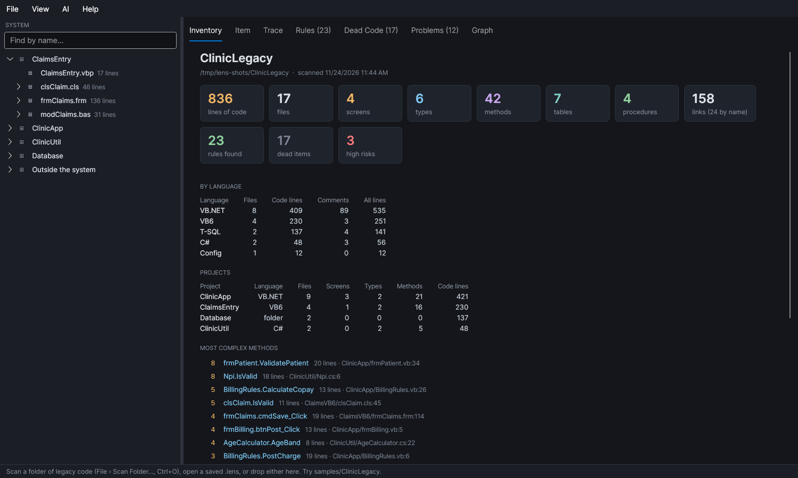

## Download

Builds for Windows, macOS and Linux (Intel/AMD and ARM) are on the
[releases page](https://github.com/Harlock123/AVALegacyLens/releases). Unzip or untar and run `AVALegacyLens`
(`AVALegacyLens.exe` on Windows); nothing else needs installing.

## What it reads

| Source | How | What it gets |
|---|---|---|
| VB.NET and C# projects (`.vbproj`, `.csproj`, old style or SDK) | Roslyn: each project compiled against the .NET runtime | Types, methods, properties, constructors; calls, object creations, inheritance; size and complexity |
| WinForms screens | Roslyn over the designer code (`InitializeComponent`) | Each control with its type, text, place, size and limits, inside its panel or group box; event handlers (`Handles`, `AddHandler`, `+=`); the controls code reads or sets |
| Visual Basic 6 (`.vbp`, `.frm`, `.bas`, `.cls`, `.ctl`) | A reader of its own, line by line | Forms' controls from their headers (twips to pixels, frames, control arrays), procedures, handlers bound by name, calls and `New` across the project, ActiveX controls, `Declare`s |
| T-SQL scripts | Microsoft's own parser (ScriptDom), batch by batch | Tables with columns, keys, defaults and checks; procedures, views, functions and triggers, with the tables and columns each reads and writes and what it runs |
| SQL inside code | The same parser, on the strings in VB.NET, C# and VB6 | What each method reads, writes and runs; SQL built by joining strings is read with stand-ins for the run-time parts and marked as a guess |
| A live SQL Server | Its catalog views only (File › Add Database…) | The same as scripts, from the database itself. **No table's rows are read**, and the connection string isn't kept |
| Config files | `app.config`, `web.config` | Connection strings (server, database, user; the password never kept), settings (secrets masked), and the shares and web addresses outside the system |

Every link says how sure the scan is of it: **resolved** (a compiler bound it), **by name** (matched by name: across
projects and languages, and all of VB6), or **guessed** (from SQL built at run time). Nothing is guessed silently.

## The window

The system's tree is on the left: projects, their files, the screens with their controls, types and methods, the
database's tables, columns and procedures, and what's outside the system. Find by name (Ctrl+F) above it.

**Item** shows the selected thing's source with its own lines highlighted, its properties (a method's signature and
complexity, a control's text and limits, a column's type and key), what it uses and what uses it, each link with its
line. Click a link to see its line; double-click to go there.

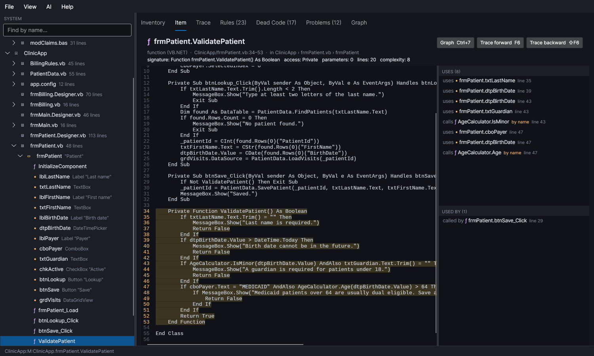

**Trace** (F6) follows the program from the selected item: a screen to its controls, a button to its handler, a method
to everything it calls, runs, reads and writes, a write to the triggers it fires. **Backward** (Shift+F6) goes from a
table, a column or any code up to the buttons and screens that reach it, and on to whatever opens those screens.

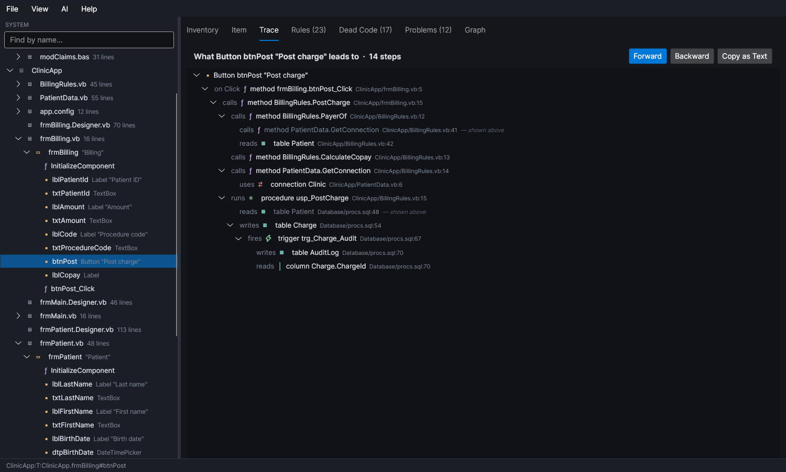

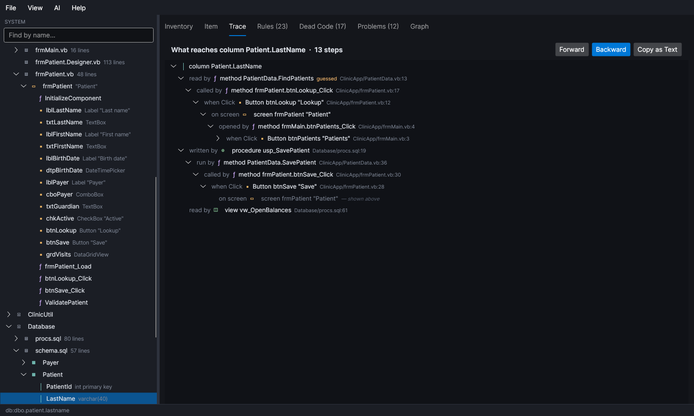

**Graph** (Ctrl+7) draws the selected item's neighbourhood, one or two steps out: what drives it on the left, what it
drives on the right, the links coloured by kind and dashed where they're only matched by name. Click an item to move
there.

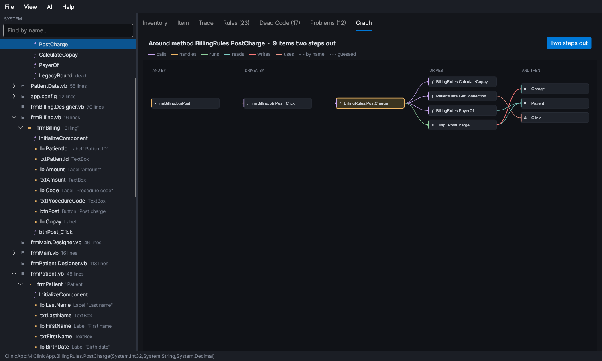

Procedures, views and tables show their SQL, from the script or the live database:

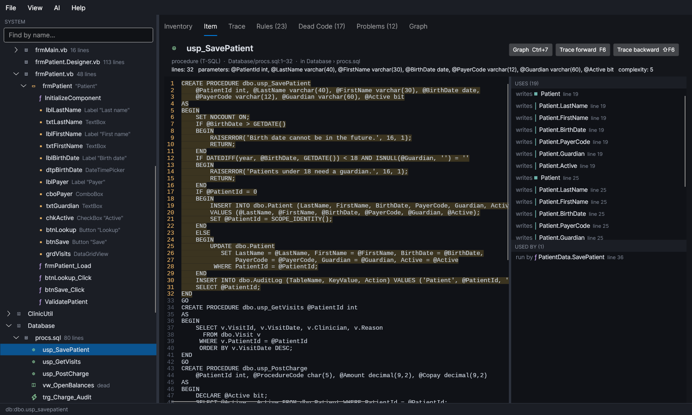

## Rules, dead code, risks and the estimate

**Rules** lists the business rules found, in the original's own words where it has them: a check that shows a message
and stops (*validation*), one that only warns (*notice*), a Select Case or switch over literal values (*decision*), a
number written into the code (*limit*), a database CHECK constraint (*constraint*), a CASE in SQL (*calculation*), a
guard in a check function (*guard*). The same rule in a screen and in a procedure is found in both places, so the
rebuild keeps one on purpose. Mark each one ✓ confirmed, ✗ wrong or – noise: marks are saved with the scan and carried
to a rescan.

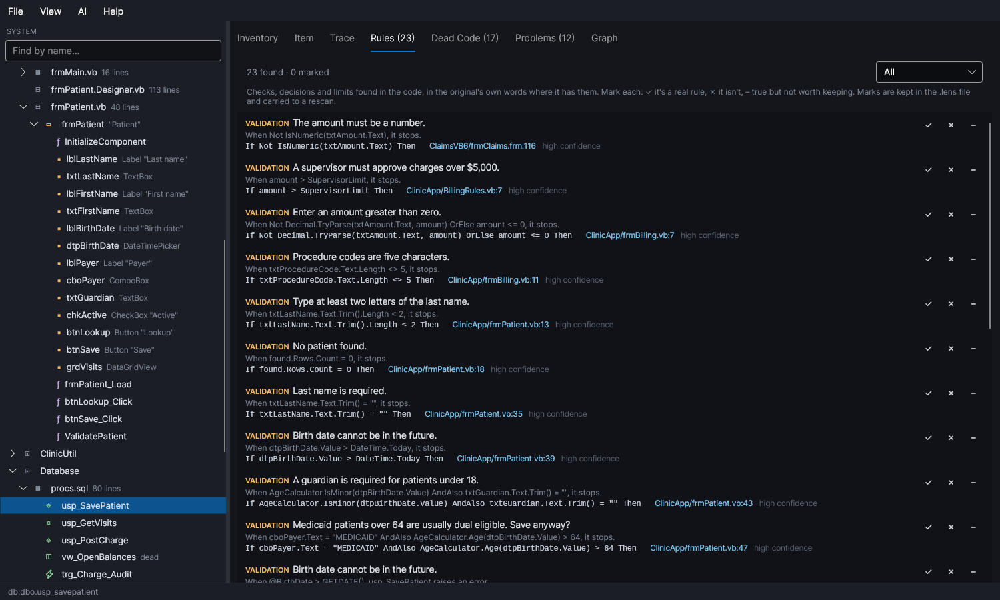

**Dead Code** lists what nothing reaches from the system's entry points (the startup screen, Main, the framework's
callbacks, a library's public members when nothing scanned uses the library): methods, screens, types, procedures,
views, tables, settings and connections. *Unused* means nothing refers to it at all; *unreachable* means only dead code
does. Each has a confidence: high for private code nothing calls, lower where something outside the scan (a report, a
job, reflection, data binding) might still use it.

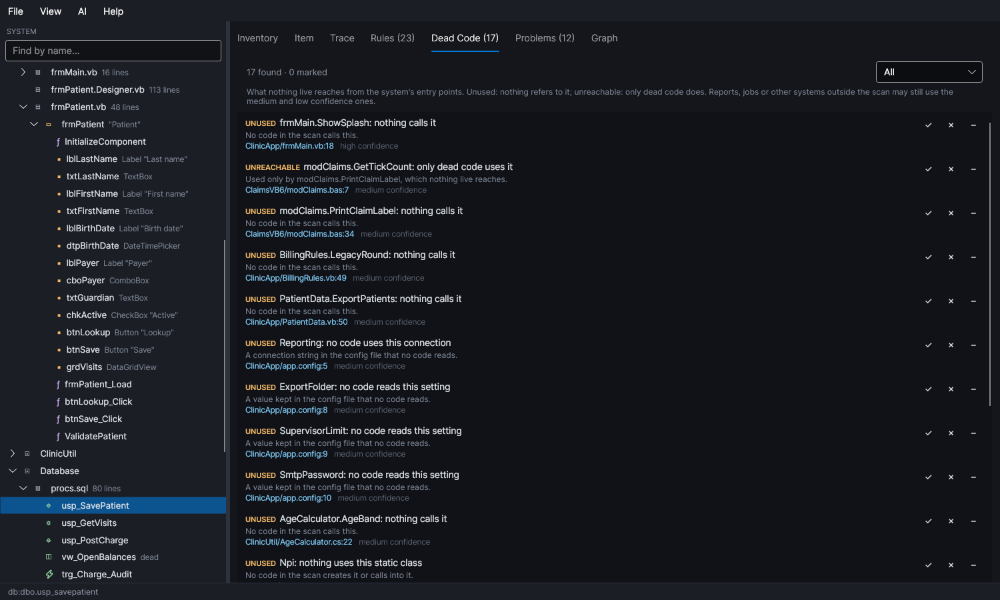

**Problems** lists the risks, worst first: SQL built by joining strings (open to injection), dynamic SQL, passwords and
servers written into code, errors ignored with On Error Resume Next, native Windows calls, ActiveX controls, global
state, secrets in config files, SELECT *, data access in screen code, very complex or long methods.

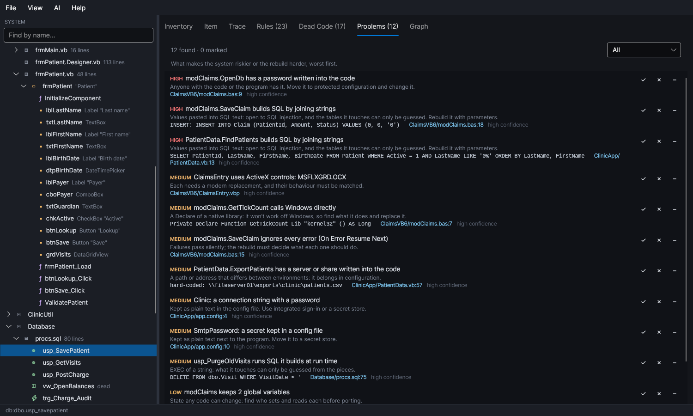

The Inventory ends with an **estimate**: a rough size for rebuilding the live part, in person-days with a range, from
counts the scan is sure of (screens by their controls, methods and procedures by complexity, tables, high risks, rules
to confirm) and stated weights. Dead code and findings marked wrong or noise are left out. It's a starting point to argue
with, not a quote.

## Reports and hand-offs

- **File › Export Report…** writes the lot as one HTML page (no outside links) or an Excel workbook (a sheet each for
  the summary, estimate, rules, dead code, risks, screens, tables with who writes and reads each column, and methods).
- **File › Export Parity Plan…** writes an [AVAParityCheck](https://github.com/Harlock123/AVAParityCheck) suite
  (`.parity`): a check for each table the live code writes, old database against new, keyed on its primary key, with
  money compared within 0.01, dates as dates, text trimmed and the columns the database stamps itself ignored; and one
  for each procedure the live code runs that returns rows. Each check's note says what writes the table and from which
  buttons, and how many rules guard it. The databases are named connections, "old" and "new", set up in AVAParityCheck:
  no connection string is written.
- **File › Export Screens as AXAML…** drafts the selected screen (or every live screen) as an Avalonia window for
  [AVAUIDesigner](https://github.com/Harlock123/AVAUIDesigner): the same controls at the same places and sizes, each
  mapped to its Avalonia counterpart (limits and items kept, tab controls as tabs, frames and panels as bordered
  canvases, VB6 control arrays one control each, anything without a counterpart as a placeholder saying what it was),
  and a comment at each event naming the old handler and the rules it checks.

The tests open every draft in AVAUIDesigner and the parity plan in AVAParityCheck, through their own MCP servers. Here
is AVAUIDesigner drawing the drafts of the sample's VB.NET Patient screen and VB6 Claims screen, and of
[X12 Explorer](https://github.com/Harlock123/X12_820Explorer)'s own VB.NET original:

<p>
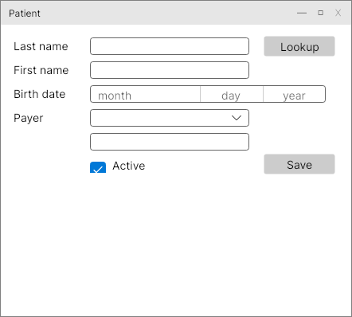
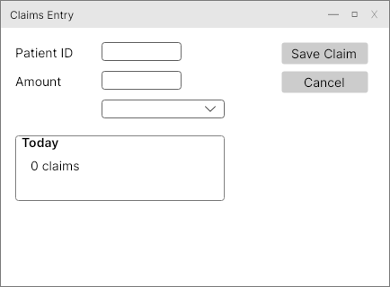
</p>

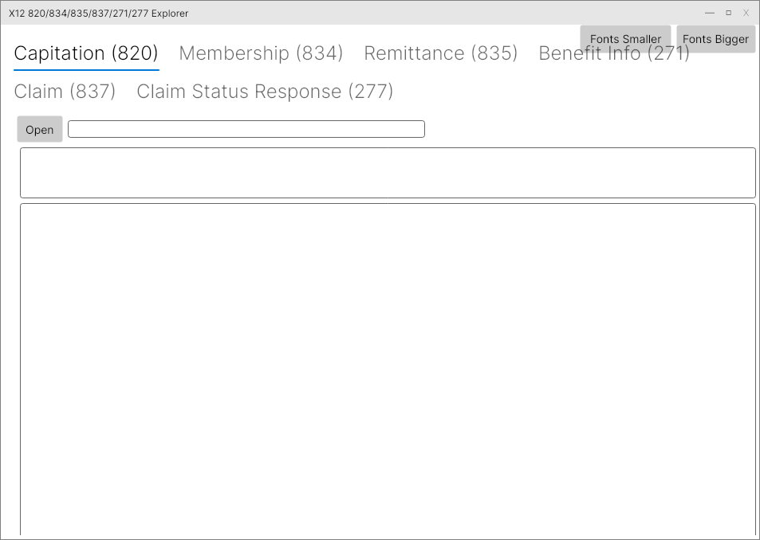

A scan saves as a `.lens` file (File › Save Lens, Ctrl+S) with people's marks, to open again without rescanning or to
compare with a later scan.

## AI: the chat and agents

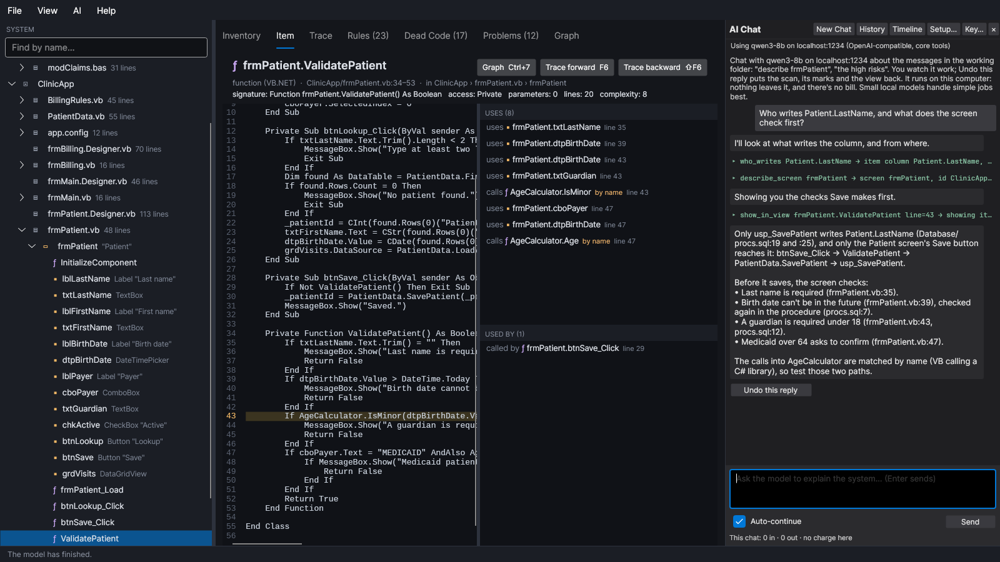

**The AI Chat** (F12, or AI › AI Chat) docks on the right. Ask about the system open in the window: "what does the
patient screen do?", "who writes Patient.LastName?", "what would break if we dropped usp_PurgeOldVisits?", "how big is a
rebuild?". The model reads the map with the same tools outside agents get, shows you what it means by selecting items
in the window, and answers citing file and line, saying when a link is only matched by name or guessed. **Undo this
reply** puts the scan, its marks and the view back (files it wrote are kept).

Setup… chooses the model, through either of two APIs:

- **Anthropic API**: Claude (Opus, Sonnet or Haiku), with your Anthropic API key (Key…, or `ANTHROPIC_API_KEY`). Or a
  server on this computer or your network that speaks the same API, such as **LM Studio** (`http://localhost:1234`) or
  **Ollama** (`http://localhost:11434`). A local server needs no key.
- **OpenAI-compatible**: LM Studio, Ollama, vLLM, llama.cpp, OpenAI or another cloud service, or a company gateway.

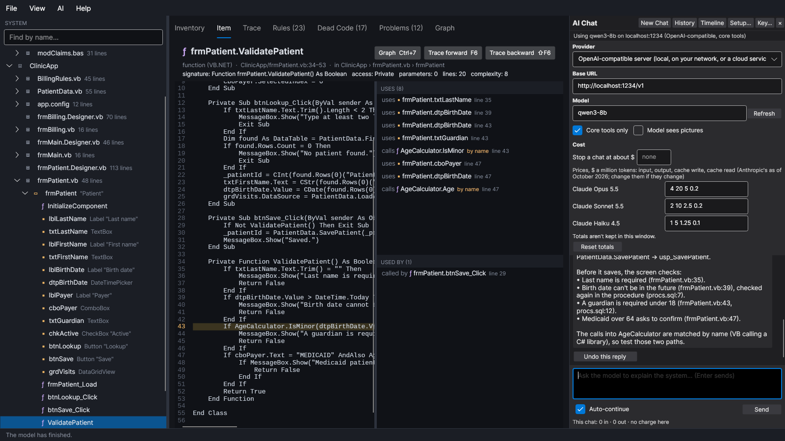

For a small local model, tick **Core tools only** (14 tools in place of 35). A model on your own computer sends nothing
anywhere and costs nothing; Claude's use is counted as it goes, with an optional budget.

**What agents can see.** Code and schema, never data. Everything an agent gets (source lines, link notes, properties,
reports) has passwords masked, and the connection strings of databases you added are never in an answer: agents can
scan with them but not read them. The tests call every tool on the sample, with a database password in the session,
and read every file the agents write: they fail if any password reaches an agent.

**Agents outside the program.** Claude Code, Claude Desktop or any MCP client can work with the open window: turn on
AI › Allow AI Agents (MCP), then add the server, for Claude Code:

```bash
claude mcp add avalegacylens -- /path/to/AVALegacyLens --mcp --attach
```

Without `--attach`, `AVALegacyLens --mcp --root FOLDER [--database CONNECTION]` is a server with no window that scans
that folder. AI › Connect an Agent also opens a network door (MCP over HTTP, port **8776**, with an access token, or
`AVALegacyLens --mcp --http 8776` headless, with the token from `--token` or `AVALEGACYLENS_MCP_TOKEN`) for agents on
other computers. `AVALegacyLens --mcp --help` lists the options.

**The tools** (35). Everything reads, except that agents may scan, mark findings when you've said what they are,
select things in the window, and write new files inside the working folder (never over one that was there):

| Group | Tools |
|---|---|
| The scan | `list_files`, `scan`, `open_lens`, `save_lens`, `get_inventory`, `compare_scans` |
| Items | `find`, `get_node` (an item with its links both ways and its findings), `list_children`, `get_source` (passwords masked) |
| How things connect | `trace` (forward or backward, with files and lines), `who_writes`, `who_reads` (a table or column, and the buttons that reach each writer), `list_screens`, `describe_screen` (controls, events, and what each leads to), `explain_sql` (pasted SQL against the schema) |
| Findings | `list_rules`, `list_dead_code`, `list_risks`, `mark_finding`, `get_estimate` |
| Reports and hand-offs | `export_report` (.html, .xlsx), `export_parity_plan` (.parity), `export_axaml` (.axaml drafts) |
| The view | `render_view` (a picture of an item's code or a trace), `get_view`, `show_in_view` |
| Working in steps | `batch`, `get_recording`, `save_steps` and `run_steps` (a session's calls with `${parameters}`, to run on another system), `checkpoint`, `diff`, `render_checkpoint`, `restore_checkpoint` |

**Recipes** (MCP prompts, 8): a screen end to end, the rules behind a table, what a change would break, the rebuild
estimate, a rules catalogue, the risky code, the parity checks, and porting a screen to Avalonia. Each is a
step-by-step plan with the exact tool calls; the tests run every one, call by call, on the sample.

## Trying it

Scan [`samples/ClinicLegacy`](samples/ClinicLegacy), an invented clinic system made to exercise every part of the scan:

- `ClinicApp`: a VB.NET WinForms front desk (a main menu, a Patient screen, a Billing screen, the data module and the
  billing rules), calling a C# library and SQL Server, with SQL built by joining strings, a hard-coded share and some
  dead code.
- `ClinicUtil`: the C# library (ages, NPI check digits).
- `ClaimsVB6`: a VB6 claims screen with a frame, a control array and an ActiveX grid, a module with a hard-coded
  connection string and On Error Resume Next, and a class.
- `Database`: the tables, procedures, a view, a trigger and dynamic SQL.

Its passwords are made up for the tests that check they never leak. Don't add real code to the repository.

## Building

You need the [.NET 10 SDK](https://dotnet.microsoft.com/download).

```bash
dotnet build AVALegacyLens.slnx
dotnet run --project src/AVALegacyLens [folder | file.lens]
dotnet run --project src/AVALegacyLens -- --mcp --root samples/ClinicLegacy     # the MCP server on stdio
dotnet test AVALegacyLens.slnx
```

## Testing

The tests cover the scan of each language (projects, files, line counts, types and methods, calls resolved and matched
by name, designer controls and handlers, VB6 forms and procedures, T-SQL definitions and bodies, SQL in code, config
files), who writes every column of the sample, traces both ways, every rule, dead item and risk the sample has (so a
change that finds more or fewer fails), the estimate, marks, `.lens` files, the reports and hand-offs; every MCP tool
through a real MCP client; every recipe call by call; the no-leak test; the chat on scripted fakes of both model APIs;
the window, headless; and the pipe and network doors. No real model, key or user settings are used. Some tests are
opt-in:

```bash
LENS_TEST_MSSQL="Server=localhost,1433;User Id=sa;Password=…;TrustServerCertificate=True" dotnet test   # a live SQL Server
LENS_UIDESIGNER=/path/to/AVAUIDesigner LENS_PARITYCHECK=/path/to/AVAParityCheck dotnet test --filter HandoffTests
LENS_LIVE_SERVER=http://localhost:11434 LENS_LIVE_MODEL=qwen3:1.7b dotnet test --filter LiveModelTests
LENS_SHOTS=/tmp/shots dotnet test --filter Screenshots
```

The first runs the sample's scripts into a new database on that server, reads its catalog, and checks it reads like the
scripts (then drops the database). The second opens every draft in AVAUIDesigner and the parity plan in AVAParityCheck.
The third runs the chat on a real model. The last writes the README's pictures.

## Project structure

- `src/AVALegacyLens.Core`: the scan, with no user interface code.
  - `Model/`: `SystemMap` (nodes, links, findings and marks), `LensFile`.
  - `Scanning/`: `SourceFiles`, `LineCounter`, `DotNetReader` (Roslyn), `WinFormsReader`, `Scanner`.
  - `Sql/`: `SqlReader` (ScriptDom), `EmbeddedSqlReader`, `DatabaseReader` (a live catalog), `SqlNames`.
  - `Vb6/Vb6Reader`, `Config/ConfigReader`, `Secrets` (masking).
  - `Findings/`: rules (`DotNetRules`, and in the SQL and VB6 readers), `Analysis` (dead code and risks), `Estimate`,
    `Report` (HTML and Excel).
  - `Handoff/`: `ParityPlan`, `AxamlDraft`. And `Trace`, `Neighbourhood`, `Inventory`, `Usage`.
- `src/AVALegacyLens.Mcp`: the MCP server: its tools (`LensTools*.cs`), recipes, the working folder, hosting, the pipe
  and network doors and the `--mcp` command line.
- `src/AVALegacyLens`: the window (`MainWindow*`, built in code), the graph, the agents' pictures (`ViewPainter`), and
  `Agents/`: the AI Chat, the window's side of the doors, `--mcp` with no window, and the settings.
- `tests/AVALegacyLens.Tests`: xUnit v3, with Avalonia.Headless for the window.
- `samples/ClinicLegacy`: the invented system.

## Licence

MIT. Copyright (c) 2026 Lonnie Watson.
